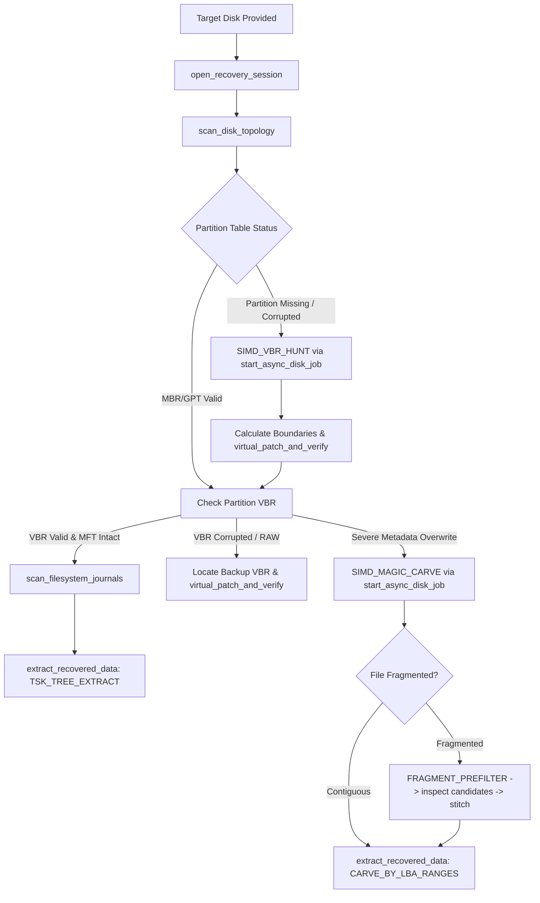

# AGENTS.md — RecoveryAI System Instructions for AI Agents

> **Standardized Context & Operating Instructions for Autonomous Coding & Forensics Agents**  
> Compatible with: Antigravity IDE, Cursor, Claude Code, Windsurf, GitHub Copilot, OpenAI Codex.

---

## 1. Project Mission & Architecture Overview

**RecoveryAI** is a high-performance, SIMD-accelerated, safety-enforced Digital Forensics and Data Recovery Engine designed to interface directly with AI Agents via the **Model Context Protocol (JSON-RPC 2.0 over stdio)**.

### Monorepo Structure
```
RecoveryAI/
├── bin/
│   └── recoveryai-mcp.js          # Cross-platform Node.js / npx launcher bridge
├── crates/
│   ├── core-io/                   # Low-level 4KB DMA aligned read-only Win32 I/O & RAM Copy-on-Write overlay
│   ├── disk-parsers/              # SIMD Aho-Corasick scanner, Shannon entropy, MBR/GPT, NTFS/FAT/exFAT
│   ├── external-bridges/          # Async subprocess runners for The Sleuth Kit (TSK), PhotoRec, GNU ddrescue
│   └── mcp-server/                # JSON-RPC 2.0 stdio server implementing 8 MCP tools + legacy aliases
├── target/release/mcp-server.exe  # Production compiled native binary (panic=abort, stripped)
├── .agents/skills/                # Specialized domain skills for AI agents
│   ├── disk-forensics/            # Low-level partition, VBR, and bad sector investigation
│   ├── filesystem-repair/         # Virtual in-memory patch recipes for NTFS, FAT32, exFAT
│   ├── file-carving-and-defrag/   # Header/footer parsing & boundary coherence fragment reassembly
│   └── mcp-disk-automation/       # Asynchronous job orchestration and non-blocking telemetry
├── mcp_config.json                # Standard MCP client configuration
└── package.json                   # NPM package definition for npx execution
```

---

## 2. The 3 Non-Negotiable Invariants (Golden Rules)

1. **Strict 100% Read-Only Physical Access:**
   - Physical drives (`\\.\PhysicalDriveX`) and image files are opened exclusively with Win32 `GENERIC_READ` and `FILE_SHARE_READ | FILE_SHARE_WRITE`.
   - **NEVER** attempt or propose raw physical writes.
2. **Virtual Sandbox Isolation (Copy-on-Write):**
   - All partition table rebuilds, boot sector fixes, and cluster pointer repairs MUST be simulated in the RAM overlay via `virtual_patch_and_verify`.
   - The original physical disk remains untouched at all times.
3. **Progressive Disclosure (< 5KB Payloads):**
   - High-level tools return concise summaries.
   - Large sector dumps (`inspect_sector_structure`) must specify small sector spans (e.g., `count: 1` or `count: 8`).
   - Deep cluster carving jobs must be dispatched asynchronously via `start_async_disk_job`.

---

## 3. MCP Tool Matrix & Signature Reference

The engine exposes 8 standard tools via JSON-RPC 2.0 stdio:

| Tool Name | Latency | Purpose | Key Arguments |
|:---|:---:|:---|:---|
| `list_physical_drives` | Fast (<300ms)| Enumerates all internal/external disks, USBs & enclosures with recommendations | None |
| `open_recovery_session` | Fast (<50ms) | Validates target disk path, measures sector geometry & bad sector map | `path: string` (e.g. `\\.\PhysicalDrive1` or `case.img`) |
| `scan_disk_topology` | Fast (<100ms) | Fast MBR, GPT primary/backup, and known partition boundary inspection | `session_id: string` |
| `inspect_sector_structure` | Fast (<50ms) | Hex & ASCII inspection + Shannon entropy calculation of sector ranges | `session_id: string`, `lba: int`, `count: int` |
| `scan_filesystem_journals`| Medium (<1s) | Scans NTFS `$MFT` unallocated records, `$UsnJrnl`, and FAT root clusters | `session_id: string`, `partition_start_lba: int` |
| `start_async_disk_job` | Immediate (<10ms)| Dispatches heavy background jobs (`SIMD_MAGIC_CARVE`, `FRAGMENT_PREFILTER`, `DD_RESCUE_CLONE`) | `session_id: string`, `job_type: string`, `params: object` |
| `poll_async_job` | Fast (<5ms) | Non-blocking telemetry for active background tasks | `session_id: string`, `job_id: string` |
| `virtual_patch_and_verify`| Fast (<50ms) | Tests MBR/VBR repairs in RAM Copy-on-Write overlay without physical write | `session_id: string`, `lba: int`, `patch_hex: string` |
| `extract_recovered_data` | Disk-bound | Exports verified files/partitions to safe destination folder | `session_id: string`, `source_type: string`, `target_dir: string` |

---

## 4. Diagnostics & Decision Workflow for AI Agents



---

## 5. Development & Testing Commands

- **Build Native Engine:**
  ```bash
  cargo build --release
  ```
  *(Note: When building with GNU MinGW toolchain, ensure `RUSTFLAGS="-C panic=abort"` is set)*
- **Run Unit Tests:**
  ```bash
  cargo test
  ```
- **Run E2E Forensic Test Suite:**
  ```bash
  python tests/test_e2e_recovery.py
  ```
- **Launch MCP Server directly via Node:**
  ```bash
  node bin/recoveryai-mcp.js
  ```
- **Test with MCP Inspector:**
  ```bash
  npx @modelcontextprotocol/inspector node bin/recoveryai-mcp.js
  ```
