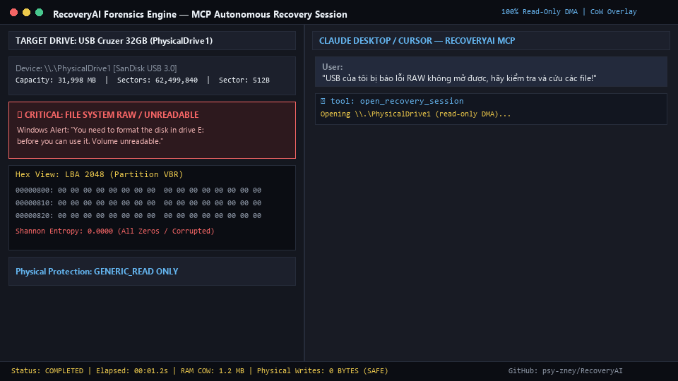

<div align="center">

# 🛡️ RecoveryAI
**Low-Level Disk Forensics & Data Recovery MCP Engine in Rust**

[](https://www.rust-lang.org/)
[-blue)](https://modelcontextprotocol.io/)
[](#safety-architecture-in-memory-virtual-overlay)
[](./LICENSE)

*Turn Claude, Cursor, or Gemini into a Digital Forensics & Data Recovery Specialist — without ever writing a single byte to your damaged drive.*

[Architecture](#hybrid-brain--muscle-architecture) • [Safety Guarantee](#safety-architecture-in-memory-virtual-overlay) • [Quick Start](#quick-start) • [MCP Tools](#mcp-tools-catalog) • [Forensic Playbooks](#built-in-forensic-skills--playbooks)

</div>

---

<div align="center">



*Split-screen: Corrupted RAW USB Drive (Left) diagnosed and rescued in 15 seconds via Claude Desktop + RecoveryAI MCP (Right) with Zero Physical Disk Writes.*

</div>

## Why RecoveryAI?

When a USB drive or hard disk turns `RAW`, loses its partition table, or suffers from corrupted `$MFT` / `FAT` headers, users face a painful choice:
1. **Commercial GUI tools ($70–$100+):** Expensive, black-box scanners that often fail on complex structural corruption or fragmented media (`moov` atom separation in MP4s, broken SQLite B-trees).
2. **Open-source CLI forensics (`TestDisk`, `The Sleuth Kit`, `ddrescue`, Hex Editors):** Extremely powerful, but require deep knowledge of LBA offsets, Boot Sector byte structures, and manual hex patching.

**RecoveryAI bridges this gap.** However, you cannot simply feed a 500GB raw disk image into an LLM's context window. 

RecoveryAI implements a **Hybrid Brain & Muscle Architecture**:
* **The Muscle (Rust + AVX2 SIMD):** Handles raw 4KB-aligned DMA disk I/O, SCSI hardware timeouts, gigabyte-per-second signature scanning, Shannon entropy calculation ($0.0 - 8.0\text{ bits/byte}$), and zero-copy struct parsing (`MBR`, `GPT`, `NTFS`, `FAT32/exFAT`, `ext4`).
* **The Brain (AI Agent via MCP):** Receives ultra-compact **< 5KB JSON Anomaly Reports**, diagnoses structural corruption, tests hex patches safely in **RAM (Copy-on-Write Overlay)**, and orchestrates file extraction.

---

## Hybrid "Brain & Muscle" Architecture

```text
┌─────────────────────────────────────────────────────────────────────────┐
│                    AI AGENT (Claude / Cursor / Gemini)                  │
│  • Reads Forensic Playbooks (.agents/skills/)                           │
│  • Analyzes <5KB JSON Anomaly Maps & formulates recovery strategies     │
└───────────────────────────────────▲─────────────────────────────────────┘
                                    │ Model Context Protocol (JSON-RPC stdio)
┌───────────────────────────────────▼─────────────────────────────────────┐
│                        MCP SERVER (crates/mcp-server)                   │
│  • Async Job Queue (Prevents MCP timeouts on multi-terabyte scans)      │
│  • Virtual Disk Overlay (BTreeMap<LBA, 512] [u8;> In-Memory Patching)   │
└───────────────────────────────────▲─────────────────────────────────────┘
                                    │ Rust Internal API / Zero-Copy Structs
┌───────────────────────────────────▼─────────────────────────────────────┐
│                 NATIVE ENGINE (core-io / disk-parsers)                  │
│  • Layer 0 (Hardware I/O): 4KB-Aligned DMA, 500ms SCSI Watchdog         │
│  • Layer 1 (SIMD Scanner): AVX2 Magic Bytes & Shannon Entropy Map       │
│  • Layer 2 (FS Parsers): MBR, GPT, NTFS ($MFT, $I30, $UsnJrnl), FAT32   │
│  • Layer 3 (Bridges): Bifragment Coherence Matcher + TSK / ddrescue     │
└─────────────────────────────────────────────────────────────────────────┘
```

---

## Safety Architecture: In-Memory Virtual Overlay

Allowing an AI Agent to directly modify sectors on a damaged physical drive is dangerous. **RecoveryAI enforces a strict hardware-level Read-Only policy:**

1. **Immutable Physical Access:** Physical drives (`\\.\PhysicalDriveX` on Windows, `/dev/sdX` on Linux) are opened exclusively with `GENERIC_READ` / `O_RDONLY` and `FILE_FLAG_NO_BUFFERING`. Write handles do not exist in the codebase.
2. **Copy-on-Write (CoW) RAM Patching:** When the AI Agent wants to rebuild a destroyed MBR or restore a corrupted NTFS Volume Boot Record (VBR) from its end-of-volume backup, it calls `virtual_patch_and_verify`.
3. **Instant Mount Simulation:** The patch is stored in an in-memory `BTreeMap<u64, [u8; 512]>` (`crates/core-io/src/virtual_overlay.rs`). All filesystem parsers read through this overlay, immediately reporting back to the AI whether the root directory tree mounts cleanly—without touching a single bit on the physical USB/disk.

---

## Quick Start

### 1. Zero-Install via `npx` (MCP Client Configuration)

Add `RecoveryAI` to your `claude_desktop_config.json` or `.cursor/mcp.json`:

```json
{
  "mcpServers": {
    "recoveryai": {
      "command": "npx",
      "args": ["-y", "recoveryai-mcp", "--read-only-enforced"]
    }
  }
}
```

### 2. Build from Source (Rust Workspace)

Prerequisites: **Rust 1.80+** (Cargo). For physical drive access on Windows, run your terminal/client as **Administrator**.

```bash
git clone [https://github.com/psy-zney/RecoveryAI.git](https://github.com/psy-zney/RecoveryAI.git)
cd RecoveryAI

# Optional: Download companion forensic binaries (The Sleuth Kit, PhotoRec, ddrescue)
pwsh ./scripts/download_binaries.ps1

# Build optimized release binary with AVX2/SIMD enabled
cargo build --release

# Run End-to-End synthetic corruption tests (Safe 1GB virtual images)
python ./tests/create_sample_images.py
python ./tests/test_e2e_recovery.py
```

---

## MCP Tools Catalog

RecoveryAI exposes **8 token-efficient tools** designed around *Progressive Disclosure*:

| Tool Name | Layer | Description |
| :--- | :--- | :--- |
| `open_recovery_session` | Layer 0 | Opens a physical drive or `.img` file in Read-Only DMA mode and initializes the RAM Virtual Overlay. |
| `scan_disk_topology` | Layer 1/2 | Rapidly inspects LBA 0 (MBR), LBA 1..33 (GPT), Backup GPT, and common VBR offsets. Returns a `<2KB` JSON anomaly map. |
| `inspect_sector_structure` | Layer 2 | Casts raw sectors into zero-copy structs (`MBR`, `GPT`, `NTFS_VBR`, `FAT32_BPB`, `MFT_ENTRY`), highlighting corrupted fields and Shannon Entropy ($0.0 - 8.0$). |
| `scan_filesystem_journals` | Layer 2 | Parses `$MFTMirr`, `$UsnJrnl`, `$I30` directory indexes (NTFS), or backup FAT tables to locate recently deleted files. |
| `start_async_disk_job` | Layer 1/3 | Launches non-blocking background threads for `DD_RESCUE_CLONE`, `SIMD_VBR_HUNT`, `SIMD_MAGIC_CARVE`, or `FRAGMENT_PREFILTER`. |
| `poll_async_job` | Bridge | Streams real-time progress (`MB/s`, `bad_sectors_count`, discovered LBA hits) without timing out the MCP connection. |
| `virtual_patch_and_verify` | Layer 0/2 | Applies hex patches or sector copies in RAM and simulates mounting the filesystem to verify directory tree integrity. |
| `extract_recovered_data` | Layer 3 | Extracts recovered files (incorporating active RAM patches or stitched cluster ranges) to a safe destination directory. |

---

## Built-in Forensic Skills & Playbooks

RecoveryAI ships with an AI-native `.agents/skills/` knowledge base (inspired by [REA](https://github.com/morluto/rea)) that equips AI coding assistants and agents with structured forensic SOPs:

* **`disk-forensics/`**: Partition table reconstruction (`01_partition_recovery.md`), RAW NTFS repair (`02_ntfs_raw_repair.md`), FAT32/exFAT backup boot sector restoration (`03_fat_exfat_repair.md`), hardware bad sector triage (`05_bad_sector_rescue.md`), and laptop recovery scenarios (`06_laptop_recovery_scenarios.md`).
* **`file-carving-and-defrag/`**: Statistical boundary coherence matching (`01_boundary_coherence.md`), fragmented MP4/MOV `moov`/`mdat` atom reconstruction (`02_mp4_mov_atom_repair.md`), and corrupted SQLite B-tree page salvage (`03_sqlite_database_salvage.md`).
* **`filesystem-repair/`**: Deep `$MFT` record surgical repair (`01_ntfs_mft_recovery.md`), FAT32 `FSInfo` reconstruction (`02_fat32_exfat_fsinfo.md`), and Linux `ext4` backup Superblock recovery (`03_ext4_superblock_recovery.md`).
* **`mcp-disk-automation/`**: Asynchronous job orchestration patterns (`01_async_job_orchestration.md`).

---

## Project Structure

```text
RecoveryAI/
├── .agents/skills/          # 4 Specialized AI Forensic Skill Modules & 13 Playbooks
├── ai-context/              # Decision trees & tool catalogs for LLM context injection
├── bin/                     # Node.js NPX wrapper for instant MCP integration
├── crates/
│   ├── core-io/             # 4KB-aligned DMA buffers, SCSI watchdog, RAM Virtual Overlay
│   ├── disk-parsers/        # Zero-copy MBR/GPT/NTFS/FAT structs, SIMD carver, Defrag matcher
│   ├── external-bridges/    # Headless wrappers for The Sleuth Kit, PhotoRec, GNU ddrescue
│   └── mcp-server/          # Tokio JSON-RPC stdio server & Async Job Manager
└── tests/                   # Synthetic disk corruption generator & E2E verification suite
```

## Disclaimer & Safety Notice

Data recovery on failing hardware carries inherent physical risks. If a drive is making mechanical clicking noises, **unplug it immediately** and seek a cleanroom lab. RecoveryAI is strictly read-only at the software layer, but scanning a dying NAND flash chip or degraded platter can accelerate hardware failure—always use the `DD_RESCUE_CLONE` workflow first when `bad_sectors_count > 0`.

## License

Licensed under the [MIT License](./LICENSE).